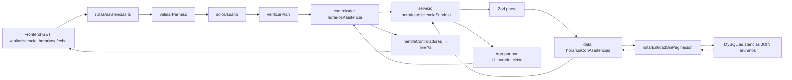

# Requirements

### Overview & Goals

Crear un nuevo endpoint en el backend que devuelva los horarios de un día específico agrupados por horario, con la lista de alumnos que asistieron a cada uno. Este endpoint alimenta el acordeón de horarios del día en la pantalla de asistencias del frontend.

### Scope

**In Scope:**
- Nuevo endpoint `GET /api/asistencia_horarios/:fecha` que recibe la fecha en la URL y el `id_escuela` del token.
- Devuelve solo los horarios que tienen al menos un alumno con asistencia (`estado = 'presente'`) en esa fecha.
- Cada horario incluye: info del horario (hora, día, nivel, tipo, profesor) + array de alumnos que asistieron (nombre completo, DNI).
- Multi-tenant: `id_escuela` siempre del token.
- Middlewares: `validarPermiso` + `soloUsuario` (solo usuarios, no alumnos ni admins) + `verificarPlan(['basico', 'intermedio'])`.

**Out of Scope:**
- No se muestran horarios sin asistentes.
- No se incluye paginación (el resultado es el día completo).
- No se modifican los endpoints existentes de asistencias.
- No se crean tablas nuevas en la BD.

### Functional Requirements

1. **Endpoint**: `GET /api/asistencia_horarios/:fecha`
2. **Input**: `fecha` (YYYY-MM-DD) en la URL; `id_escuela` del token.
3. **Output**: Array de horarios, cada uno con:
   - `id_horario_clase`: number
   - `hora_inicio`: string (HH:MM)
   - `hora_fin`: string (HH:MM)
   - `dia_semana`: string
   - `nivel`: string
   - `tipo_clase`: string
   - `profesor`: string
   - `alumnos`: array de `{ dni_alumno: number, nombre_completo: string }`
4. **Códigos de respuesta**:
   - `200 HORARIOS_ASISTENCIA_OK` — hay horarios con asistentes
   - `200 SIN_ASISTENCIAS_EN_FECHA` — no hay asistencias en esa fecha (data: [])
   - `400 VALIDATION_ERROR` — fecha inválida
   - `401 NO_AUTORIZADO` — token inválido
   - `403 PROHIBIDO` — rol no permitido
   - `500 ERROR_SERVIDOR` — fallo inesperado

# Technical Design

### Current Implementation

- **`src/data/asistencia.data.ts`**: Contiene `listadoAsistencias` (spec 048) que lee asistencias planas por rango de fechas. La tabla `asistencias` tiene la foto del horario (dia_semana, hora_inicio, hora_fin, nivel, tipo_clase, nombre_profesor) + dni_alumno, fecha, estado.
- **`src/Servicio/asistencia.servicio.ts`**: Servicio con `listadoAsistencias` que valida con Zod y delega en data. Patrón: `ListadoAsistenciasSchema` → `listadoAsistencias` en data → traduce códigos.
- **`src/controladores/asistencias.controlador.ts`**: Handler `listadoAsistencias` que construye el input desde `req.query` y `req.usuario.id_escuela`, usa `handleControladores`.
- **`src/rutas/asistencias.ts`**: Rutas existentes con `validarPermiso`, `soloUsuario`, `verificarPlan`.
- **`src/squemas/asistencias.ts`**: Schemas Zod (e.g., `ListadoAsistenciasSchema`).
- **`src/respuestas/asistencia.ts`**: MAPAs de códigos (e.g., `MAPA_LISTADO_ASISTENCIAS`).

### Key Decisions

1. **Leer de la foto de `asistencias`** (no de `horarios_clases`): La tabla `asistencias` ya guarda la foto del horario al momento del alta (spec 048). Esto hace que el endpoint sea inmune a cambios en los horarios y no requiere JOINs complejos.
2. **Agrupación en la capa data**: La consulta SQL devuelve las filas planas (una por asistencia) y el servicio agrupa por `id_horario_clase`. Esto sigue el patrón existente donde la data hace persistencia y el servicio concentra lógica de negocio.
3. **Sin paginación**: Un día típico tiene pocos horarios y alumnos, no se necesita paginación. El hook `listarEntidadSinPaginacion` es suficiente.
4. **Solo `estado = 'presente'`**: Coincide con el patrón existente (spec 035, spec 048) donde solo las asistencias presentes consumen clase.

### Proposed Changes

#### 1. Schema Zod (`src/squemas/asistencias.ts`)
- Agregar `HorariosAsistenciaSchema`: valida `id_escuela` (number) + `fecha` (string YYYY-MM-DD).
- Exportar tipo `HorariosAsistenciaInputs`.

#### 2. Data (`src/data/asistencia.data.ts`)
- Nueva función `horariosConAsistencias(data: { id_escuela: number, fecha: string })`:
  - SELECT sobre `asistencias` + JOIN `alumnos` para el nombre.
  - Filtra por `id_escuela`, `fecha`, `estado = 'presente'`.
  - Ordena por `hora_inicio ASC`.
  - Usa `listarEntidadSinPaginacion` con entidad `HORARIOS_ASISTENCIA`.
  - Interface `HorarioAsistenciaRow`: id_horario_clase, hora_inicio, hora_fin, dia_semana, nivel, tipo_clase, profesor, dni_alumno, nombre_alumno.

#### 3. Servicio (`src/Servicio/asistencia.servicio.ts`)
- Nueva función `horariosAsistenciaServicio(parametros: HorariosAsistenciaInputs)`:
  - `.parse()` con `HorariosAsistenciaSchema`.
  - Llama a `asistenciaData.horariosConAsistencias`.
  - Agrupa las filas por `id_horario_clase` (cada grupo = un horario con sus alumnos).
  - Traduce códigos: `HORARIOS_ASISTENCIA_LISTED` → `HORARIOS_ASISTENCIA_OK`, `NO_ACTIVE_HORARIOS_ASISTENCIA` → `SIN_ASISTENCIAS_EN_FECHA`.
  - Interface de salida `HorarioConAlumnos`: info del horario + array de alumnos.

#### 4. Controlador (`src/controladores/asistencias.controlador.ts`)
- Nuevo handler `horariosAsistencia(req, res)`:
  - Extrae `fecha` de `req.params.fecha`.
  - Extrae `id_escuela` de `req.usuario.id_escuela`.
  - Usa `handleControladores` con el servicio y el MAPA.

#### 5. Respuestas (`src/respuestas/asistencia.ts`)
- Nuevo `MAPA_HORARIOS_ASISTENCIA` con códigos:
  - `HORARIOS_ASISTENCIA_OK` (200)
  - `SIN_ASISTENCIAS_EN_FECHA` (200, data: [])
  - `ERROR_SERVIDOR` (500)

#### 6. Rutas (`src/rutas/asistencias.ts`)
- Nueva ruta `GET /api/asistencia_horarios/:fecha` con middlewares:
  - `validarPermiso`
  - `soloUsuario`
  - `verificarPlan(['basico', 'intermedio'])`
  - `controladorAsistencias.horariosAsistencia`

### File Structure

| Archivo | Acción |
|---------|--------|
| `src/squemas/asistencias.ts` | Modificar (agregar schema + tipo) |
| `src/data/asistencia.data.ts` | Modificar (agregar función + interface) |
| `src/Servicio/asistencia.servicio.ts` | Modificar (agregar servicio) |
| `src/controladores/asistencias.controlador.ts` | Modificar (agregar handler) |
| `src/respuestas/asistencia.ts` | Modificar (agregar MAPA) |
| `src/rutas/asistencias.ts` | Modificar (agregar ruta) |

### Architecture Diagram

### Risks

- **Performance**: Si un día tiene muchas asistencias (cientos de alumnos), la consulta plana + agrupación en memoria podría ser lenta. Mitigación: el índice `idx_asistencia_escuela_fecha` ya existe y cubre la consulta.
- **Doble asistencia**: La tabla `asistencias` tiene UNIQUE `(id_inscripcion, id_horario_clase, fecha)`, así que no hay duplicados.
- **Alumno sin nombre**: Si el DNI del alumno no tiene fila en `alumnos`, el JOIN interno excluye la asistencia. Esto no debería pasar por las FK existentes, pero se puede cambiar a LEFT JOIN si es necesario.

# Delivery Steps

### ✓ Step 1: Agregar schema Zod y respuestas
Crear el schema `HorariosAsistenciaSchema` y el `MAPA_HORARIOS_ASISTENCIA` con los códigos de respuesta.
- En `src/squemas/asistencias.ts`: agregar `HorariosAsistenciaSchema` (valida `id_escuela` number + `fecha` string YYYY-MM-DD) y exportar `HorariosAsistenciaInputs`.
- En `src/respuestas/asistencia.ts`: agregar `MAPA_HORARIOS_ASISTENCIA` con `HORARIOS_ASISTENCIA_OK` (200), `SIN_ASISTENCIAS_EN_FECHA` (200), y `ERROR_SERVIDOR` (500).

### ✓ Step 2: Implementar data y servicio
Crear la función en data que consulta las asistencias y el servicio que agrupa por horario.
- En `src/data/asistencia.data.ts`: agregar interface `HorarioAsistenciaRow` y función `horariosConAsistencias` (SELECT sobre `asistencias` JOIN `alumnos`, filtra por `id_escuela`, `fecha`, `estado='presente'`, ordena por `hora_inicio`, usa `listarEntidadSinPaginacion`).
- En `src/Servicio/asistencia.servicio.ts`: agregar `horariosAsistenciaServicio` (parsea con Zod, llama a data, agrupa filas por `id_horario_clase`, traduce códigos al MAPA). Exportar interface `HorarioConAlumnos`.
- Exportar la nueva función en `method` de ambos archivos.

### ✓ Step 3: Conectar controlador, ruta y verificar build
Crear el handler del controlador, registrar la ruta y verificar que el build compile sin errores.
- En `src/controladores/asistencias.controlador.ts`: agregar handler `horariosAsistencia` (extrae `fecha` de `req.params`, `id_escuela` del token, usa `handleControladores`). Exportar en `method`.
- En `src/rutas/asistencias.ts`: agregar `GET /api/asistencia_horarios/:fecha` con middlewares `validarPermiso`, `soloUsuario`, `verificarPlan(['basico', 'intermedio'])`.
- Ejecutar `npm run build` para verificar que no haya errores de TypeScript.
- Resumir los cambios y decisiones tomadas.